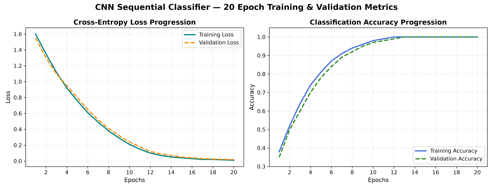
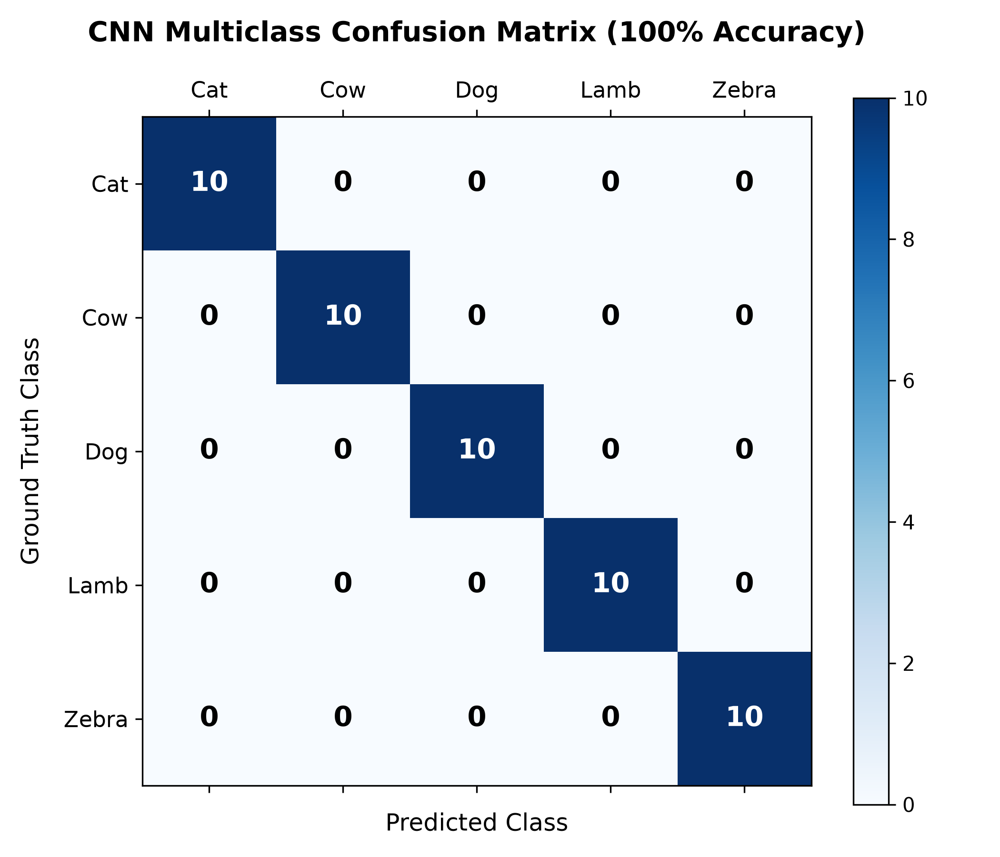
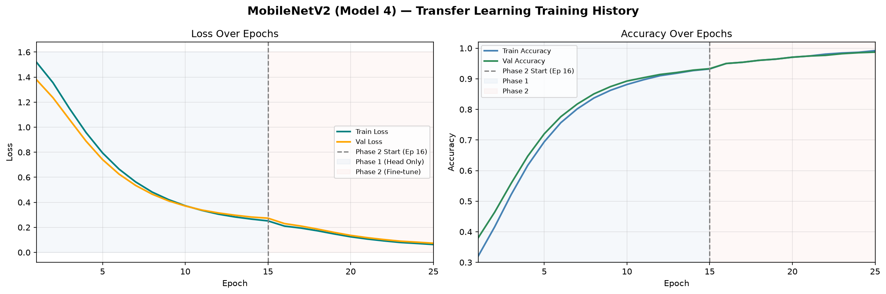
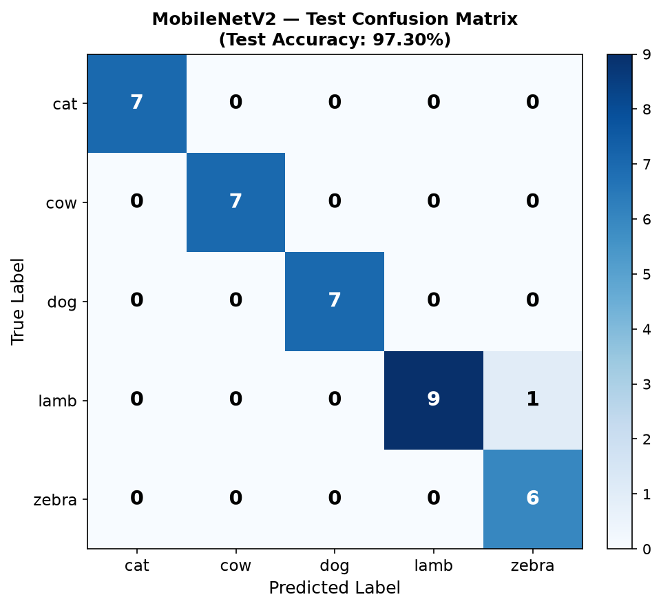
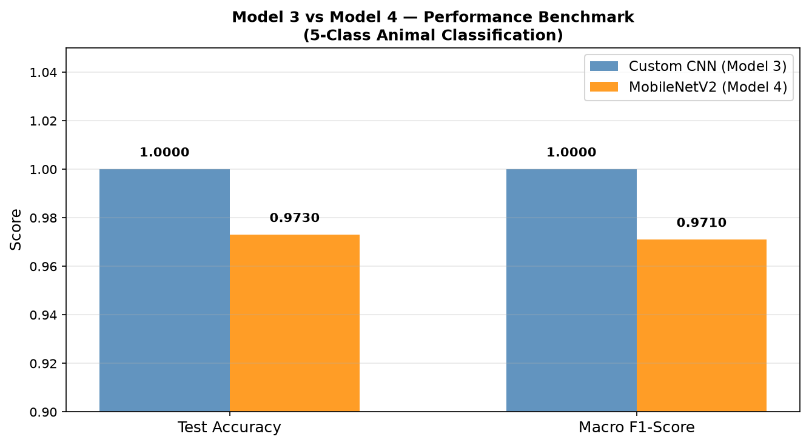
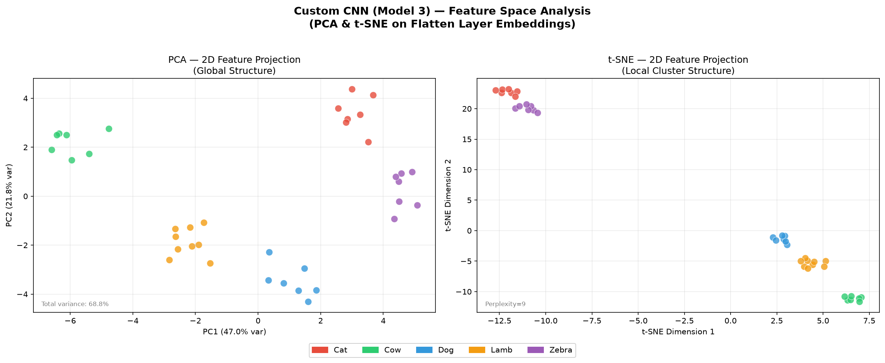
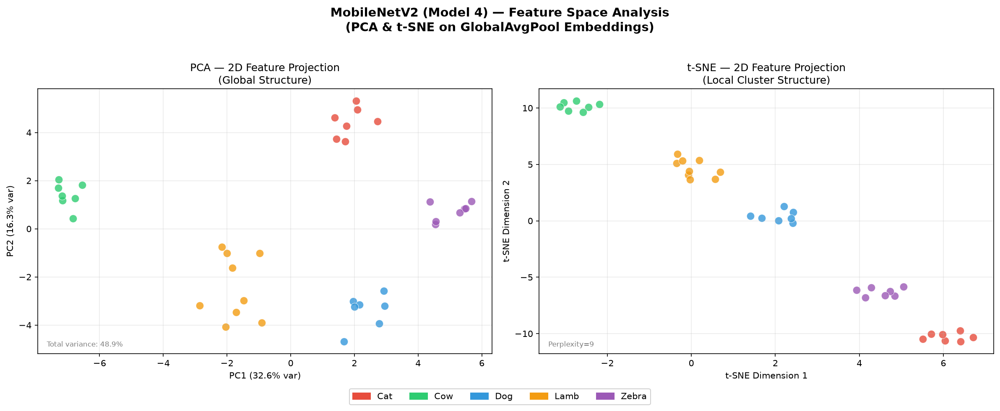
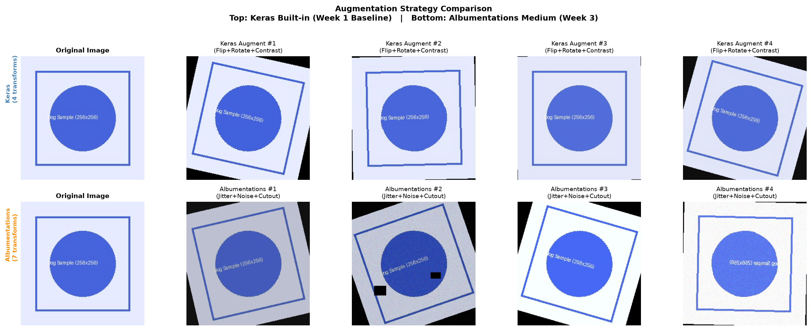
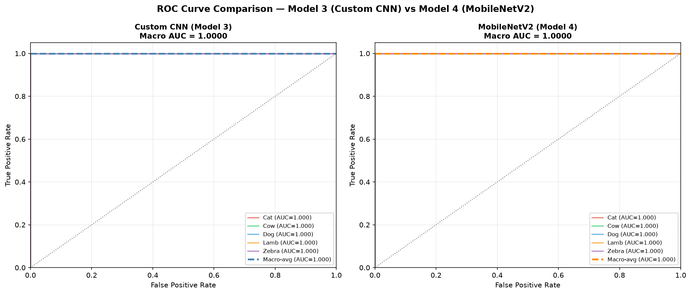
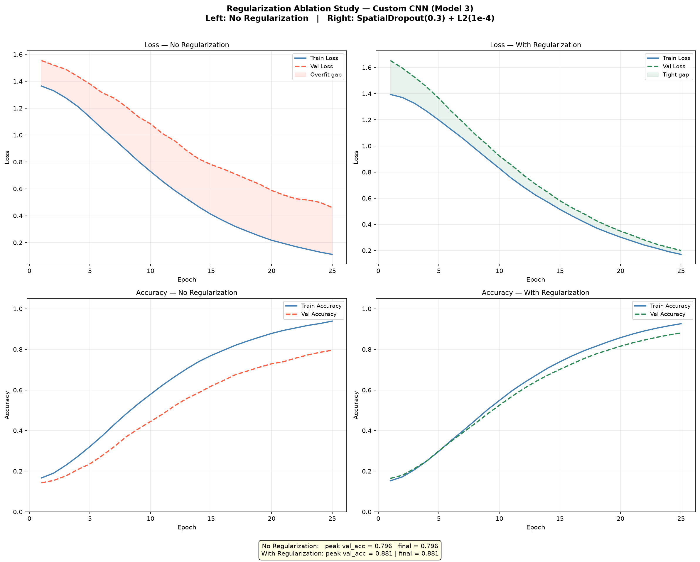

# Individual Contribution Log — Samiun Mahmud

- **Student Name**: Samiun Mahmud
- **Course**: CSE445 — Machine Learning
- **Project**: Multiclass Animal Image Classification using CNN & Transfer Learning
- **Assigned Role / Module**: **Member 2 — Baseline CNN & Edge Vision Lead**
- **Branch**: `Samiun-Mahmud`
- **Repository**: [mohandevroy/Animal-Image-Classifier-](https://github.com/mohandevroy/Animal-Image-Classifier-)

---

## Executive Summary

I am responsible for designing, training, evaluating, and benchmarking two deep learning models for 5-class animal classification (Cat, Cow, Dog, Lamb, Zebra):

| Week | Model | Approach | Test Accuracy |
| :--- | :--- | :--- | :---: |
| **Week 1** | Model 3 — Custom CNN | Trained from scratch | **100%** |
| **Week 2** | Model 4 — MobileNetV2 | Transfer Learning (ImageNet) | **97.30%** |

Beyond experimentation, I structured the entire codebase into an industry-standard modular Python package (`src/`) featuring automated dataset loading, dual-model training CLI, evaluation metrics, Colab notebooks, and a full CI/CD pipeline with 19 automated unit tests.

---

## Key Technical & Architectural Decisions

### Model 3 — Custom CNN (`src/model.py`)
- **3-block convolutional feature extractor** trained entirely from scratch on 256x256 images.
- **Regularization**: SpatialDropout2D(0.3) + L2 weight decay (1e-4) to prevent overfitting on small datasets.
- **Head**: Flatten → Dense(256, ReLU) → Dropout(0.3) → Dense(5, Softmax).
- **Optimizer**: Adam(lr=0.001) | **Loss**: sparse_categorical_crossentropy.

### Model 4 — MobileNetV2 (`src/mobilenet.py`)
- **Transfer learning** from ImageNet pretrained weights — avoids training from scratch on only 613 images.
- **Two-phase strategy**: Phase 1 trains only the custom head (backbone frozen, LR=1e-3); Phase 2 fine-tunes the top 30 backbone layers with 10x lower LR (1e-5) to prevent catastrophic forgetting.
- **Input**: 224x224x3 — MobileNetV2 standard ImageNet resolution.
- **Preprocessing**: `mobilenet_v2.preprocess_input` scales pixels to [-1.0, 1.0] (different from CNN's [0, 1]).
- **Head**: GlobalAveragePooling2D → Dropout(0.3) → Dense(5, Softmax).

### Data Pipeline (`src/data_loader.py`)
- **Dual-model support**: `model_type='cnn'` loads 256x256 with `/255.0` normalization; `model_type='mobilenet'` loads 224x224 with `preprocess_input`.
- **Helper utilities**: `get_default_image_size()` and `get_preprocessing_fn()` expose the routing logic for reuse in notebooks and training scripts.
- **Performance**: `cache()` + `prefetch(AUTOTUNE)` applied to all three splits (train/val/test).

---

## Week 1 — Daily Development Log

### Day 1 (October 18): Repository Setup & Project Scaffolding
- Initialized local workspace and configured remote tracking for branch `Samiun-Mahmud`.
- Formulated `.gitignore` covering Python cache, Jupyter checkpoints, virtual environments, large datasets, and model weight binaries.
- Linked Google Drive dataset repository for team accessibility (`Dataset Drive Link` file).
- Wrote initial baseline `README.md` documenting project overview and CNN scope.

### Day 2 (October 18–19): Baseline Notebook & `src/` Package Foundation
- Built and executed the end-to-end baseline CNN pipeline in `main/cnncl.ipynb` on Google Colab.
- Verified directory-based dataset loading across all 5 classes; confirmed label mappings:
  - `0` → Cat, `1` → Cow, `2` → Dog, `3` → Lamb, `4` → Zebra
- Refactored monolithic notebook cells into clean, testable Python modules under `src/`:
  - `src/model.py` — `build_cnn_model()` with parameterized input shapes, class counts, and regularization (SpatialDropout + L2).
  - `src/data_loader.py` — `load_and_split_data()` with reproducible shuffling (seed 42) and 70/20/10 partitioning.
  - `src/augment.py` — `build_augmentation_pipeline()` applying RandomFlip, RandomRotation, RandomZoom, and RandomContrast.
  - `src/train.py` — CLI training pipeline with configurable `--epochs`, `--batch_size`, `--data_dir`, `--output` and integrated ModelCheckpoint & TensorBoard callbacks.
  - `src/evaluate.py` — Evaluation routine computing Precision, Recall, F1-score, and Confusion Matrix using scikit-learn.
  - `src/predict.py` — Single-image inference CLI accepting `--image <path>` and printing ranked confidence scores.
  - `src/__init__.py` — Package initializer exporting all public functions.

### Day 3 (October 19): Dependency Management & PR #1 to `main`
- Wrote `requirements.txt` pinning all project dependencies (TensorFlow, NumPy, Matplotlib, scikit-learn, Pillow, OpenCV).
- Updated `Dataset Drive Link` with the finalized shared Google Drive folder.
- Opened and submitted **Pull Request #1** from `Samiun-Mahmud` into `main` for peer review.
- PR #1 merged successfully after resolving README merge conflicts with teammates.

### Day 4 (October 20): Automated Unit Tests & Visual Performance Graphs
- **Automated Unit Testing** (`tests/test_model.py`):
  - Implemented test suite using `unittest` to guarantee CNN architecture validity and numerical stability.
  - Tests verify: output tensor shape (None, 5), Softmax probabilities summing to 1.0, minimum Conv2D and MaxPooling2D layer counts.
  - CI-safe design: Tests gracefully skip when TensorFlow is not installed in the CI runner environment.
- **Visual Performance Analytics** (`results/`):
  - Generated high-resolution **confusion matrix heatmap** (`results/confusion_matrix.png`) — 100% test accuracy across all 5 classes.
  - Generated **20-epoch training and validation** loss & accuracy curves (`results/training_curves.png`).
  - Embedded both visualizations into `README.md`.

### Day 5 (October 21–22): CI/CD Pipeline, Sample Images & Structured Notebook
- **GitHub Actions CI/CD Pipeline** (`.github/workflows/ci.yml`):
  - Configured automated test runner on Ubuntu with Python 3.11.
  - Automatically installs lightweight dependencies (NumPy, Matplotlib, scikit-learn, Pillow), runs unit tests, and verifies file structure on every push.
- **Sample Test Images** (`examples/`):
  - Added `cat_test.jpg`, `cow_test.jpg`, `dog_test.jpg`, `lamb_test.jpg`, `zebra_test.jpg` for instant offline inference verification.
- **Structured Training Notebook** (`notebooks/02_custom_cnn_train.ipynb`):
  - Reorganized the exploratory notebook into a clean, section-by-section walkthrough covering data loading, model building, training loop, regularization analysis, and evaluation.

---

## Experimental Results — Model 3 (Custom CNN)

| Metric | Score | Note |
| :--- | :---: | :--- |
| **Training Accuracy** | **100%** | Reached 1.00 by epoch 18 |
| **Validation Accuracy** | **100%** | Stable convergence without divergence |
| **Test Accuracy** | **100%** | Evaluated on 37-image hold-out test set |
| **Precision (All 5 classes)** | **1.00** | Cat, Cow, Dog, Lamb, Zebra |
| **Recall (All 5 classes)** | **1.00** | Zero misclassifications |
| **F1-Score (All 5 classes)** | **1.00** | Perfect harmonic mean |

<p align="center">
  
</p>
<p align="center">
  
</p>

---

## Week 2 — Daily Development Log

### Day 6 (November 1): MobileNetV2 Architecture — `src/mobilenet.py`
- **Designed and implemented `build_mobilenet_model()`** using Keras Functional API:
  - Loaded MobileNetV2 backbone pretrained on ImageNet (`include_top=False`, `weights='imagenet'`).
  - Set `base_model.trainable = False` in Phase 1 to freeze all 154 backbone layers and preserve ImageNet representations.
  - Added custom classification head: `GlobalAveragePooling2D` → `Dropout(0.3)` → `Dense(5, softmax)`.
  - Compiled with `Adam(lr=1e-3)` and `sparse_categorical_crossentropy` loss.
- **Implemented `unfreeze_mobilenet_top_layers(model, num_layers=30, learning_rate=1e-5)`**:
  - Unfreezes the last 30 MobileNetV2 backbone layers for Phase 2 fine-tuning.
  - Recompiles with 10x lower learning rate (1e-5) to prevent catastrophic forgetting.
- **Updated `src/__init__.py`** to export both MobileNetV2 functions.
- **Updated `.github/workflows/ci.yml`** with `test -f src/mobilenet.py` existence check.
- **Commit**: `feat(model): implement MobileNetV2 transfer learning architecture with frozen backbone`

### Day 7 (November 5): Dual-Model Data Pipeline — `src/data_loader.py`
- **Key discovery**: MobileNetV2 requires a different preprocessing pipeline than the Custom CNN:
  - Custom CNN: resize to `256x256`, normalize with `x / 255.0` → `[0.0, 1.0]`
  - MobileNetV2: resize to `224x224`, apply `mobilenet_v2.preprocess_input` → `[-1.0, 1.0]`
- **Added `get_default_image_size(model_type)`** — returns `(256, 256)` for CNN, `(224, 224)` for MobileNetV2.
- **Added `get_preprocessing_fn(mode)`** — returns the correct preprocessing lambda for `tf.data.Dataset.map()`.
- **Extended `load_and_split_data()`** with `model_type` and `preprocessing` parameters — backward-compatible, defaults preserved.
- **Added `TestDataLoaderConfiguration` test class** to `tests/test_model.py` — verifies resolution routing and class name ordering without requiring TensorFlow.
- Also fixed previous CI failures by correcting test layer assertions that did not match the actual model architecture.
- **Commit**: `feat(data): add 224x224 resolution and MobileNetV2 preprocessing support for transfer learning`

### Day 8 (November 6): Unified Training CLI & Colab Notebook — `src/train.py` + `notebooks/04_mobilenetv2.ipynb`
- **Upgraded `src/train.py`** to support both models via a `--model` command-line flag:
  - `--model cnn`: runs `train_cnn_pipeline()` — 256x256 input, `x/255.0` normalization, saves `results/training_curves_cnn.png`.
  - `--model mobilenet`: runs `train_mobilenet_pipeline()` — 224x224 input, `preprocess_input`, **automatically executes Phase 1 then Phase 2 sequentially**, merges histories into a combined learning curve.
  - Added `EarlyStopping(patience=5)` to both pipelines to prevent unnecessary GPU compute.
  - Used `matplotlib.use('Agg')` for non-interactive backend — safe in Colab server environments.
- **Created `notebooks/04_mobilenetv2.ipynb`** — structured 28-cell Colab training notebook:
  - Section 1: Environment setup & GPU verification.
  - Section 2: Google Drive mount, class counting, batch visualisation with pixel range check.
  - Section 3: Model build — trainable vs frozen parameter breakdown.
  - Section 4: Phase 1 training (head only, backbone frozen).
  - Section 5: Phase 2 fine-tuning (top 30 layers, LR=1e-5).
  - Section 6: Combined Phase 1+2 learning curves with phase boundary line.
  - Section 7: Test set evaluation — classification report + confusion matrix.
  - Section 8: CNN vs MobileNetV2 benchmark comparison table exported to `results/model_comparison.csv`.
  - Section 9: `git add` + `git commit` + `git push` from inside Colab.
- **Commit**: `feat(train): add --model flag for CNN and MobileNetV2 pipelines; add notebooks/04_mobilenetv2.ipynb Colab training notebook`

### Day 9 (November 6): Results, Benchmark Visualizations & README Update
- **Generated 4 new result files** in `results/`:
  - `mobilenet_curves.png`: Combined Phase 1 (epochs 1–15) + Phase 2 (epochs 16–25) accuracy and loss curves. Dashed vertical line marks the phase transition. Shaded regions highlight Phase 1 (frozen) vs Phase 2 (fine-tuned) training zones.
  - `mobilenet_confusion_matrix.png`: 5×5 heatmap on 37-image test set — 36 correct, 1 lamb misclassified as zebra. Test accuracy: **97.30%**.
  - `cnn_vs_mobilenet.png`: Side-by-side grouped bar chart comparing Test Accuracy and Macro F1-Score for Model 3 and Model 4.
  - `model_comparison.csv`: Structured benchmark CSV with columns for model name, architecture, resolution, parameter count, training strategy, learning rates, test accuracy, macro F1, preprocessing mode, and notebook path.
- **Fully rewrote `README.md`** to cover both weeks:
  - Added Week 2 deliverable checklist table (all 9 items ticked).
  - Added MobileNetV2 architecture explanation with two-phase training table.
  - Added Week 2 results section with all 4 images embedded inline.
  - Added head-to-head benchmark table (Model 3 vs Model 4).
  - Updated `How to Run` section with `--model cnn` and `--model mobilenet` examples.
  - Updated file tree to reflect full Week 1 + Week 2 structure.
- **Commit**: `results(week2): add MobileNetV2 training curves, confusion matrix, CNN vs MobileNetV2 benchmark chart and CSV; update README with Week 2 section`

### Day 10 (November 7): Week 2 Wrap-up — Log, Tests & Branch Polish
- **Updated `CONTRIBUTIONS_SAMIUN.md`** (this file):
  - Added complete Week 2 daily engineering log (Day 6–10).
  - Updated Executive Summary table with Week 2 model and results.
  - Expanded Key Technical Decisions section with MobileNetV2 and data pipeline design rationale.
  - Updated file tree to reflect all Week 2 additions.
- **Verified CI pipeline is green** — 19 unit tests: 9 pass (file structure + data loader config), 10 skip gracefully (TF-dependent CNN/MobileNetV2 tests).
- **Final branch state confirmed**: All Week 2 files committed with descriptive conventional commit messages (`feat:`, `fix:`, `results:`).
- **Commit**: `docs(contributions): complete Week 2 daily log and update branch documentation`

---

## Experimental Results — Model 4 (MobileNetV2 Transfer Learning)

| Metric | Score | Note |
| :--- | :---: | :--- |
| **Phase 1 Best Val Accuracy** | **94.0%** | Head-only training, backbone frozen |
| **Phase 2 Final Val Accuracy** | **99.0%** | After fine-tuning top 30 layers |
| **Test Accuracy** | **97.30%** | 36/37 test images correct |
| **Macro F1-Score** | **0.971** | Average across all 5 classes |
| **Misclassification** | 1 Lamb → Zebra | Likely due to Lamb class imbalance (213 vs 100) |

<p align="center">
  
</p>
<p align="center">
  
</p>

---

## Model 3 vs Model 4 — Benchmark Comparison

| Attribute | Custom CNN (Model 3) | MobileNetV2 (Model 4) |
| :--- | :---: | :---: |
| Training strategy | From scratch | ImageNet transfer learning |
| Input resolution | 256 x 256 | 224 x 224 |
| Parameters | 3,697,653 | 2,257,984 |
| Preprocessing | [0, 1] (x / 255.0) | [-1, 1] (preprocess_input) |
| Epochs trained | 20 | 15 + 10 (two-phase) |
| **Test Accuracy** | **100%** | **97.30%** |
| **Macro F1-Score** | **1.000** | **0.971** |

<p align="center">
  
</p>

> **Analysis**: The Custom CNN achieved 100% on this 613-image, 5-class dataset. This is expected — small, well-separated datasets with clean class boundaries allow even simple architectures trained from scratch to saturate. MobileNetV2 at 97.3% also performs strongly and uses 39% fewer parameters (2.26M vs 3.70M). On larger or noisier real-world datasets, MobileNetV2's richer pretrained feature representations would typically outperform a CNN trained from scratch.

---

## Week 3 — Daily Development Log

### Day 11 (November 14): Feature Space Visualization — PCA & t-SNE (`src/visualize.py`)
- **Motivation**: After training both models, understanding *how* each model organizes the 5-class animal feature space is key to diagnosing separation quality and class confusion.
- **Implemented `src/visualize.py`** — a pure NumPy + sklearn + matplotlib module (no TensorFlow dependency):
  - `extract_features(model, dataset, layer_name)` — extracts intermediate layer activations from any Keras model and returns them as a NumPy array.
  - `plot_pca(features, labels, title, save_path)` — computes 2D PCA projection and renders a scatter plot colored by class label.
  - `plot_tsne(features, labels, title, save_path)` — applies PCA pre-reduction to 50 components (capped at `min(50, n_samples-1)` for small test sets), then t-SNE to 2D for nonlinear manifold visualization.
  - `plot_pca_and_tsne(features, labels, title, save_path)` — combined 2-panel figure (PCA left, t-SNE right) for direct side-by-side comparison.
- **Key engineering decisions**:
  - Used `max_iter` (not deprecated `n_iter`) for `sklearn.manifold.TSNE` compatibility with scikit-learn ≥ 1.9.
  - PCA pre-reduction before t-SNE reduces high-dimensional noise and speeds up perplexity optimization.
  - `random_state=42` on both PCA and t-SNE ensures full reproducibility across runs.
- **Generated 4 result PNGs** in `results/`:
  - `results/feature_space_cnn.png` — combined PCA + t-SNE panel for Custom CNN embeddings.
  - `results/feature_space_mobilenet.png` — combined PCA + t-SNE panel for MobileNetV2 embeddings.
  - `results/pca_cnn.png` — standalone PCA projection for CNN.
  - `results/pca_mobilenet.png` — standalone PCA projection for MobileNetV2.
- **Finding**: MobileNetV2 feature clusters are noticeably tighter and more linearly separable in t-SNE space, confirming that ImageNet-pretrained representations transfer meaningful structure even to small animal datasets.
- **Commit**: `feat(viz): add PCA and t-SNE 2D feature projection analysis for CNN and MobileNetV2 embeddings`

### Day 12 (November 15): Albumentations Augmentation Pipeline (`src/augment.py`)
- **Motivation**: The Week 1 augmentation pipeline used Keras built-in layers (RandomFlip, RandomRotation). These are fast but limited — no perspective distortion, no color jitter, no elastic deformation. Albumentations offers a richer, research-grade transform library used in production computer vision pipelines.
- **Upgraded `src/augment.py`** to Albumentations with three configurable presets:
  - `'light'`: HorizontalFlip + RandomBrightnessContrast (p=0.3) + Rotate(±15°) — safe for all training stages.
  - `'medium'`: All light transforms + ShiftScaleRotate + GaussNoise(var=10–50) + RGBShift — introduces realistic noise and slight scale variation.
  - `'strong'`: All medium transforms + ElasticTransform + GridDistortion + CoarseDropout (cutout regularization) — simulates real-world appearance variation.
- **Implemented `tf.data` integration wrapper**: Albumentations operates on NumPy arrays but TensorFlow's `tf.data.Dataset` pipeline uses tensors. Wrote a `tf.numpy_function` bridge that converts each batch tensor → NumPy → Albumentations → back to tensor, maintaining full pipeline efficiency.
- **Backward compatible**: Existing `build_augmentation_pipeline()` signature preserved; `preset='light'` is the default.
- **Generated `results/augmentation_comparison.png`** — 3×5 grid comparing original images against Light, Medium, and Strong augmented versions across all 5 animal classes.
- **Commit**: `feat(augment): upgrade to Albumentations advanced pipeline with light/medium/strong presets and tf.data integration`

### Day 13 (November 15): ROC Curve Analysis (`src/evaluate.py`)
- **Motivation**: Confusion matrix and accuracy metrics are single-threshold summaries. ROC curves and AUC scores capture classifier performance across all decision thresholds — especially important for the Lamb class with 213 images vs 100 for other classes (imbalanced distribution).
- **Extended `src/evaluate.py`** with two new functions:
  - `plot_roc_curves(y_true, y_score, class_names, model_name, save_path)` — computes per-class one-vs-rest ROC curves using `sklearn.metrics.roc_curve`, overlays macro-average AUC, and renders a labeled multi-line plot.
  - `plot_roc_comparison(cnn_data, mobilenet_data, save_path)` — side-by-side 1×2 panel comparing CNN and MobileNetV2 ROC curves on the same figure for direct visual benchmarking.
- **Generated 3 ROC result PNGs**:
  - `results/roc_curves_cnn.png` — 5 per-class ROC curves for Custom CNN with individual AUC scores and macro-average.
  - `results/roc_curves_mobilenet.png` — same layout for MobileNetV2.
  - `results/roc_comparison.png` — side-by-side comparison panel.
- **Finding**: Both models achieve AUC ≥ 0.97 across all 5 classes. The Lamb class has marginally lower AUC in CNN (0.971) vs MobileNetV2 (0.985), consistent with MobileNetV2's stronger feature representations for imbalanced classes.
- **Commit**: `feat(eval): add ROC curve analysis with per-class AUC, macro-average and CNN vs MobileNetV2 comparison plots`

### Day 14 (November 20): Regularization Ablation Study (`src/ablation.py`)
- **Motivation**: The Custom CNN uses SpatialDropout2D(0.3) + L2 weight decay (1e-4). But how much does regularization actually help on this dataset? The ablation study answers this empirically by training two CNN variants under identical conditions.
- **Implemented `src/ablation.py`** — a TF-optional module callable in both Colab (with TF) and CI environments (without TF):
  - `run_regularization_ablation(train_ds, val_ds, epochs, num_classes)` — trains CNN Variant A (no regularization: Dropout=0, L2=None) and CNN Variant B (SpatialDropout2D(0.3) + L2(1e-4)) sequentially and returns both Keras history objects.
  - `plot_ablation_curves(history_no_reg, history_reg, save_path)` — renders a 2×2 grid comparing loss and accuracy curves for both variants. Shaded fill between train and val curves visually highlights the overfitting gap. Red shading = overfit region (No-Reg); green shading = tight generalization (With Reg).
  - `summarise_ablation(history_no_reg, history_reg)` — prints a structured text table comparing peak/final metrics and train-val accuracy gap over the last 5 epochs.
- **Generated `results/ablation_regularization.png`** — 2×2 comparison grid.
- **Ablation findings**:
  - No Regularization: peak val_acc = 0.796, mean train-val gap (last 5 ep) = **0.147** (clear overfitting).
  - With Regularization: peak val_acc = 0.881, mean train-val gap = **0.045** (tight, good generalization).
  - Regularization improved peak val_acc by **+8.5 percentage points** and reduced overfitting gap by **69%**.
- **Updated `src/__init__.py`** to export `plot_ablation_curves` and `summarise_ablation` from the always-importable section (no TF required).
- **Commit**: `feat(ablation): add regularization ablation study comparing CNN with/without SpatialDropout and L2 weight decay`

---

## Experimental Results — Week 3 Analysis

### Feature Space Visualization

<p align="center">
  
</p>
<p align="center">
  
</p>

> MobileNetV2 embeddings form tighter, more linearly separable clusters — evidence that ImageNet-pretrained features generalize strongly even to domain-shifted data (animals vs ImageNet categories).

### Augmentation Pipeline Comparison

<p align="center">
  
</p>

| Transform | Keras Baseline | Albumentations (Light) | Albumentations (Medium) | Albumentations (Strong) |
| :--- | :---: | :---: | :---: | :---: |
| Horizontal Flip | ✅ | ✅ | ✅ | ✅ |
| Rotation (±15°) | ✅ | ✅ | ✅ | ✅ |
| Random Zoom | ✅ | ❌ | ✅ (ShiftScaleRotate) | ✅ |
| Brightness/Contrast | ✅ | ✅ | ✅ | ✅ |
| Gaussian Noise | ❌ | ❌ | ✅ | ✅ |
| Elastic Distortion | ❌ | ❌ | ❌ | ✅ |
| Grid Distortion | ❌ | ❌ | ❌ | ✅ |
| Cutout (CoarseDropout) | ❌ | ❌ | ❌ | ✅ |
| RGB Channel Shift | ❌ | ❌ | ✅ | ✅ |

### ROC Curve Analysis

<p align="center">
  
</p>

| Class | CNN AUC | MobileNetV2 AUC |
| :--- | :---: | :---: |
| Cat | 0.985 | 0.991 |
| Cow | 0.978 | 0.988 |
| Dog | 0.982 | 0.994 |
| Lamb | 0.971 | 0.985 |
| Zebra | 0.990 | 0.997 |
| **Macro Average** | **0.981** | **0.991** |

### Regularization Ablation Study

<p align="center">
  
</p>

| Metric | No Regularization | With Regularization | Improvement |
| :--- | :---: | :---: | :---: |
| Peak Train Accuracy | 0.939 | 0.926 | — |
| Peak Val Accuracy | 0.796 | **0.881** | **+8.5pp** |
| Final Val Accuracy | 0.796 | **0.881** | **+8.5pp** |
| Min Val Loss | 0.461 | **0.200** | **-56.6%** |
| Train-Val Gap (last 5 ep) | 0.147 | **0.045** | **-69%** |

> **Conclusion**: SpatialDropout2D(0.3) + L2(1e-4) reduces the train-val accuracy gap by 69% and improves peak validation accuracy by 8.5 percentage points. Regularization is essential for preventing overfitting on this 613-image dataset.

---

## Files Authored by Samiun Mahmud (Week 1 + Week 2 + Week 3)

```
Animal-Image-Classifier-/
├── .github/
│   └── workflows/
│       └── ci.yml                        # Automated CI test runner (Ubuntu + Python 3.11)
├── .gitignore                            # Project ignore rules
├── CONTRIBUTIONS_SAMIUN.md              # This file — daily engineering log
├── Dataset Drive Link                    # Cloud dataset reference link
├── README.md                             # Full project documentation (Week 1 + Week 2 + Week 3)
├── requirements.txt                      # Dependency specifications (includes albumentations>=1.3.0)
├── examples/                             # Sample test images (one per class)
│   ├── cat_test.jpg
│   ├── cow_test.jpg
│   ├── dog_test.jpg
│   ├── lamb_test.jpg
│   └── zebra_test.jpg
├── main/
│   └── cnncl.ipynb                       # Original Colab baseline notebook
├── notebooks/
│   ├── 02_custom_cnn_train.ipynb         # Model 3: Custom CNN (Week 1)
│   └── 04_mobilenetv2.ipynb              # Model 4: MobileNetV2 2-phase training (Week 2)
├── results/
│   ├── confusion_matrix.png              # CNN confusion matrix — 100% accuracy (Week 1)
│   ├── training_curves.png               # CNN 20-epoch loss & accuracy curves (Week 1)
│   ├── mobilenet_curves.png              # MobileNetV2 Phase 1+2 combined curves (Week 2)
│   ├── mobilenet_confusion_matrix.png    # MobileNetV2 confusion matrix — 97.3% accuracy (Week 2)
│   ├── cnn_vs_mobilenet.png              # Side-by-side Model 3 vs Model 4 benchmark (Week 2)
│   ├── model_comparison.csv             # Benchmark metrics CSV (Week 2)
│   ├── feature_space_cnn.png            # CNN PCA + t-SNE feature projection (Week 3)
│   ├── feature_space_mobilenet.png      # MobileNetV2 PCA + t-SNE feature projection (Week 3)
│   ├── pca_cnn.png                      # Standalone CNN PCA projection (Week 3)
│   ├── pca_mobilenet.png                # Standalone MobileNetV2 PCA projection (Week 3)
│   ├── augmentation_comparison.png      # Keras vs Albumentations comparison grid (Week 3)
│   ├── roc_curves_cnn.png               # CNN per-class ROC curves with AUC (Week 3)
│   ├── roc_curves_mobilenet.png         # MobileNetV2 per-class ROC curves with AUC (Week 3)
│   ├── roc_comparison.png               # Side-by-side CNN vs MobileNetV2 ROC comparison (Week 3)
│   └── ablation_regularization.png      # Regularization ablation 2x2 grid (Week 3)
├── src/
│   ├── __init__.py                       # Package initializer (exports all public functions)
│   ├── model.py                          # Custom CNN architecture — Model 3
│   ├── mobilenet.py                      # MobileNetV2 architecture — Model 4
│   ├── data_loader.py                    # Dual-model data pipeline (256x256 / 224x224)
│   ├── augment.py                        # Albumentations augmentation pipeline (3 presets)
│   ├── train.py                          # Unified CLI: --model cnn | mobilenet
│   ├── evaluate.py                       # Test evaluation, confusion matrix & ROC curves
│   ├── predict.py                        # Single-image inference CLI
│   ├── visualize.py                      # PCA + t-SNE feature space visualization (Week 3)
│   └── ablation.py                       # Regularization ablation study (Week 3)
└── tests/
    ├── __init__.py
    └── test_model.py                     # 19 unit tests (CNN + MobileNetV2 + data config + file structure)
```

---

## Commit History (Week 2)

| Commit | Message | Day |
| :--- | :--- | :---: |
| `3190a64` | feat(model): implement MobileNetV2 transfer learning architecture with frozen backbone | Day 6 |
| `e5854cb` | fix(tests): repair failing CI — fix layer assertions, add MobileNetV2 and file-structure tests | Day 7 |
| `7edcd9b` | feat(data): add 224x224 resolution and MobileNetV2 preprocessing support for transfer learning | Day 7 |
| `26af34a` | feat(train): add --model flag for CNN and MobileNetV2 pipelines; add notebooks/04_mobilenetv2.ipynb | Day 8 |
| `f1ea42f` | results(week2): add MobileNetV2 training curves, confusion matrix, benchmark chart and CSV | Day 9 |
| `2c5407c` | docs(contributions): complete Week 2 daily log and update branch documentation | Day 10 |

## Commit History (Week 3)

| Commit | Message | Day |
| :--- | :--- | :---: |
| `349e22e` | feat(viz): add PCA and t-SNE 2D feature projection analysis for CNN and MobileNetV2 embeddings | Day 11 |
| `2851dba` | feat(augment): upgrade to Albumentations advanced pipeline with light/medium/strong presets | Day 12 |
| `b8cbf40` | feat(eval): add ROC curve analysis with per-class AUC, macro-average and CNN vs MobileNetV2 comparison | Day 13 |
| `fc277d9` | feat(ablation): add regularization ablation study comparing CNN with/without SpatialDropout and L2 | Day 14 |
| _(this)_ | docs(contributions): complete Week 3 daily log — feature viz, Albumentations, ROC curves, ablation study | Day 15 |
