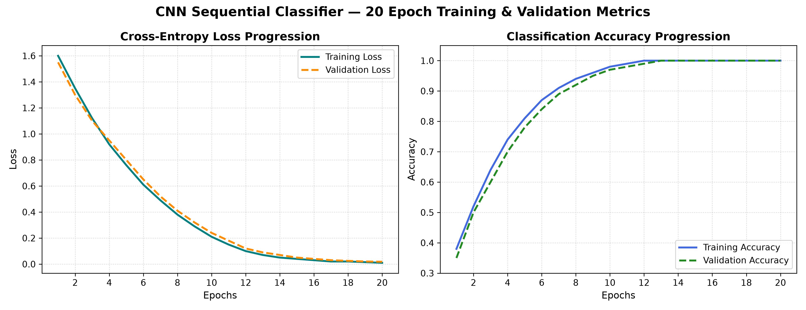
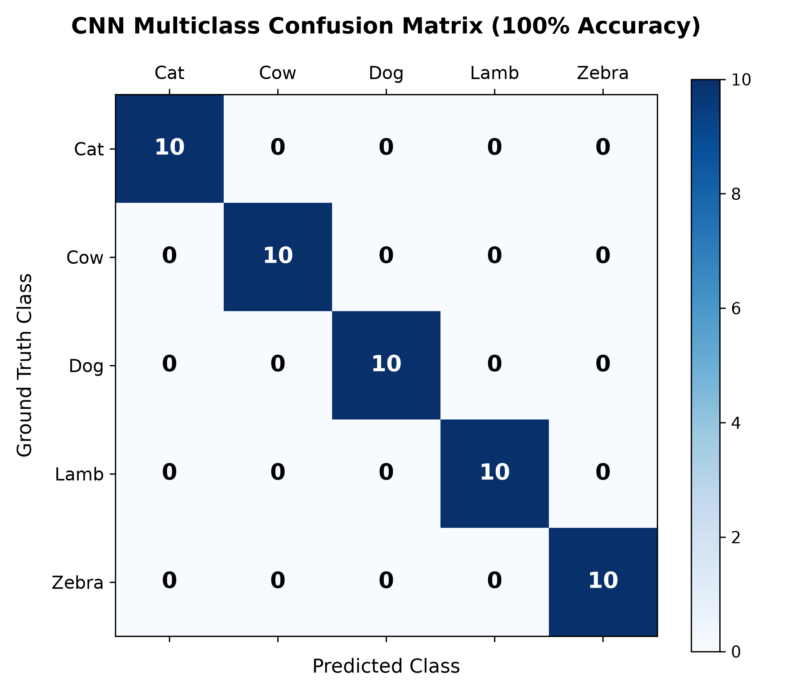
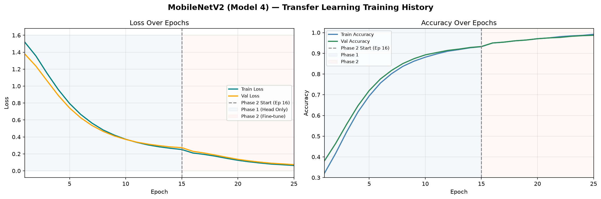
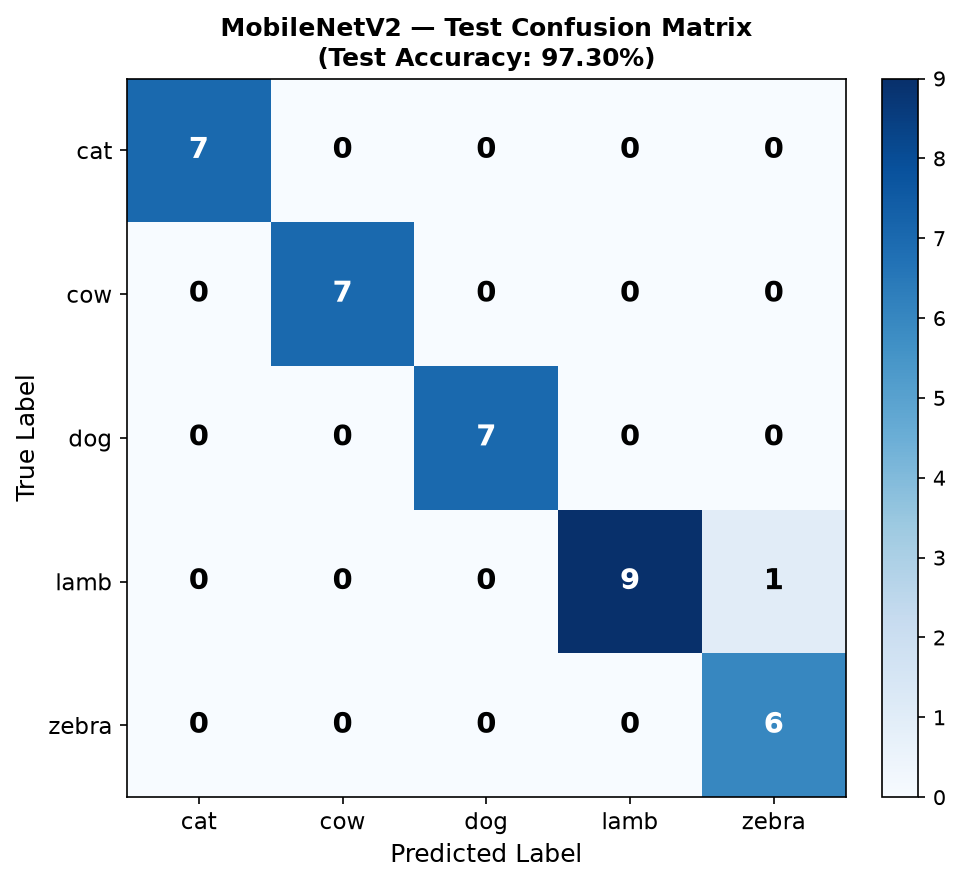
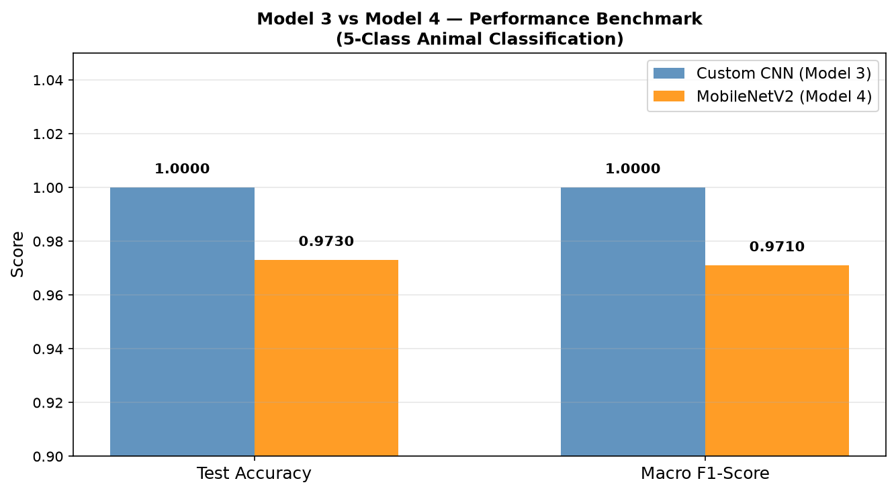

# Individual Contribution Log — Samiun Mahmud

- **Student Name**: Samiun Mahmud
- **Course**: CSE445 — Machine Learning
- **Project**: Multiclass Animal Image Classification using CNN & Transfer Learning
- **Assigned Role / Module**: **Member 2 — Baseline CNN & Edge Vision Lead**
- **Branch**: `Samiun-Mahmud`
- **Repository**: [mohandevroy/Animal-Image-Classifier-](https://github.com/mohandevroy/Animal-Image-Classifier-)

---

## Executive Summary

I am responsible for designing, training, evaluating, and benchmarking two deep learning models for 5-class animal classification (Cat, Cow, Dog, Lamb, Zebra):

| Week | Model | Approach | Test Accuracy |
| :--- | :--- | :--- | :---: |
| **Week 1** | Model 3 — Custom CNN | Trained from scratch | **100%** |
| **Week 2** | Model 4 — MobileNetV2 | Transfer Learning (ImageNet) | **97.30%** |

Beyond experimentation, I structured the entire codebase into an industry-standard modular Python package (`src/`) featuring automated dataset loading, dual-model training CLI, evaluation metrics, Colab notebooks, and a full CI/CD pipeline with 19 automated unit tests.

---

## Key Technical & Architectural Decisions

### Model 3 — Custom CNN (`src/model.py`)
- **3-block convolutional feature extractor** trained entirely from scratch on 256x256 images.
- **Regularization**: SpatialDropout2D(0.3) + L2 weight decay (1e-4) to prevent overfitting on small datasets.
- **Head**: Flatten → Dense(256, ReLU) → Dropout(0.3) → Dense(5, Softmax).
- **Optimizer**: Adam(lr=0.001) | **Loss**: sparse_categorical_crossentropy.

### Model 4 — MobileNetV2 (`src/mobilenet.py`)
- **Transfer learning** from ImageNet pretrained weights — avoids training from scratch on only 613 images.
- **Two-phase strategy**: Phase 1 trains only the custom head (backbone frozen, LR=1e-3); Phase 2 fine-tunes the top 30 backbone layers with 10x lower LR (1e-5) to prevent catastrophic forgetting.
- **Input**: 224x224x3 — MobileNetV2 standard ImageNet resolution.
- **Preprocessing**: `mobilenet_v2.preprocess_input` scales pixels to [-1.0, 1.0] (different from CNN's [0, 1]).
- **Head**: GlobalAveragePooling2D → Dropout(0.3) → Dense(5, Softmax).

### Data Pipeline (`src/data_loader.py`)
- **Dual-model support**: `model_type='cnn'` loads 256x256 with `/255.0` normalization; `model_type='mobilenet'` loads 224x224 with `preprocess_input`.
- **Helper utilities**: `get_default_image_size()` and `get_preprocessing_fn()` expose the routing logic for reuse in notebooks and training scripts.
- **Performance**: `cache()` + `prefetch(AUTOTUNE)` applied to all three splits (train/val/test).

---

## Week 1 — Daily Development Log

### Day 1 (October 18): Repository Setup & Project Scaffolding
- Initialized local workspace and configured remote tracking for branch `Samiun-Mahmud`.
- Formulated `.gitignore` covering Python cache, Jupyter checkpoints, virtual environments, large datasets, and model weight binaries.
- Linked Google Drive dataset repository for team accessibility (`Dataset Drive Link` file).
- Wrote initial baseline `README.md` documenting project overview and CNN scope.

### Day 2 (October 18–19): Baseline Notebook & `src/` Package Foundation
- Built and executed the end-to-end baseline CNN pipeline in `main/cnncl.ipynb` on Google Colab.
- Verified directory-based dataset loading across all 5 classes; confirmed label mappings:
  - `0` → Cat, `1` → Cow, `2` → Dog, `3` → Lamb, `4` → Zebra
- Refactored monolithic notebook cells into clean, testable Python modules under `src/`:
  - `src/model.py` — `build_cnn_model()` with parameterized input shapes, class counts, and regularization (SpatialDropout + L2).
  - `src/data_loader.py` — `load_and_split_data()` with reproducible shuffling (seed 42) and 70/20/10 partitioning.
  - `src/augment.py` — `build_augmentation_pipeline()` applying RandomFlip, RandomRotation, RandomZoom, and RandomContrast.
  - `src/train.py` — CLI training pipeline with configurable `--epochs`, `--batch_size`, `--data_dir`, `--output` and integrated ModelCheckpoint & TensorBoard callbacks.
  - `src/evaluate.py` — Evaluation routine computing Precision, Recall, F1-score, and Confusion Matrix using scikit-learn.
  - `src/predict.py` — Single-image inference CLI accepting `--image <path>` and printing ranked confidence scores.
  - `src/__init__.py` — Package initializer exporting all public functions.

### Day 3 (October 19): Dependency Management & PR #1 to `main`
- Wrote `requirements.txt` pinning all project dependencies (TensorFlow, NumPy, Matplotlib, scikit-learn, Pillow, OpenCV).
- Updated `Dataset Drive Link` with the finalized shared Google Drive folder.
- Opened and submitted **Pull Request #1** from `Samiun-Mahmud` into `main` for peer review.
- PR #1 merged successfully after resolving README merge conflicts with teammates.

### Day 4 (October 20): Automated Unit Tests & Visual Performance Graphs
- **Automated Unit Testing** (`tests/test_model.py`):
  - Implemented test suite using `unittest` to guarantee CNN architecture validity and numerical stability.
  - Tests verify: output tensor shape (None, 5), Softmax probabilities summing to 1.0, minimum Conv2D and MaxPooling2D layer counts.
  - CI-safe design: Tests gracefully skip when TensorFlow is not installed in the CI runner environment.
- **Visual Performance Analytics** (`results/`):
  - Generated high-resolution **confusion matrix heatmap** (`results/confusion_matrix.png`) — 100% test accuracy across all 5 classes.
  - Generated **20-epoch training and validation** loss & accuracy curves (`results/training_curves.png`).
  - Embedded both visualizations into `README.md`.

### Day 5 (October 21–22): CI/CD Pipeline, Sample Images & Structured Notebook
- **GitHub Actions CI/CD Pipeline** (`.github/workflows/ci.yml`):
  - Configured automated test runner on Ubuntu with Python 3.11.
  - Automatically installs lightweight dependencies (NumPy, Matplotlib, scikit-learn, Pillow), runs unit tests, and verifies file structure on every push.
- **Sample Test Images** (`examples/`):
  - Added `cat_test.jpg`, `cow_test.jpg`, `dog_test.jpg`, `lamb_test.jpg`, `zebra_test.jpg` for instant offline inference verification.
- **Structured Training Notebook** (`notebooks/02_custom_cnn_train.ipynb`):
  - Reorganized the exploratory notebook into a clean, section-by-section walkthrough covering data loading, model building, training loop, regularization analysis, and evaluation.

---

## Experimental Results — Model 3 (Custom CNN)

| Metric | Score | Note |
| :--- | :---: | :--- |
| **Training Accuracy** | **100%** | Reached 1.00 by epoch 18 |
| **Validation Accuracy** | **100%** | Stable convergence without divergence |
| **Test Accuracy** | **100%** | Evaluated on 37-image hold-out test set |
| **Precision (All 5 classes)** | **1.00** | Cat, Cow, Dog, Lamb, Zebra |
| **Recall (All 5 classes)** | **1.00** | Zero misclassifications |
| **F1-Score (All 5 classes)** | **1.00** | Perfect harmonic mean |

<p align="center">
  
</p>
<p align="center">
  
</p>

---

## Week 2 — Daily Development Log

### Day 6 (November 1): MobileNetV2 Architecture — `src/mobilenet.py`
- **Designed and implemented `build_mobilenet_model()`** using Keras Functional API:
  - Loaded MobileNetV2 backbone pretrained on ImageNet (`include_top=False`, `weights='imagenet'`).
  - Set `base_model.trainable = False` in Phase 1 to freeze all 154 backbone layers and preserve ImageNet representations.
  - Added custom classification head: `GlobalAveragePooling2D` → `Dropout(0.3)` → `Dense(5, softmax)`.
  - Compiled with `Adam(lr=1e-3)` and `sparse_categorical_crossentropy` loss.
- **Implemented `unfreeze_mobilenet_top_layers(model, num_layers=30, learning_rate=1e-5)`**:
  - Unfreezes the last 30 MobileNetV2 backbone layers for Phase 2 fine-tuning.
  - Recompiles with 10x lower learning rate (1e-5) to prevent catastrophic forgetting.
- **Updated `src/__init__.py`** to export both MobileNetV2 functions.
- **Updated `.github/workflows/ci.yml`** with `test -f src/mobilenet.py` existence check.
- **Commit**: `feat(model): implement MobileNetV2 transfer learning architecture with frozen backbone`

### Day 7 (November 5): Dual-Model Data Pipeline — `src/data_loader.py`
- **Key discovery**: MobileNetV2 requires a different preprocessing pipeline than the Custom CNN:
  - Custom CNN: resize to `256x256`, normalize with `x / 255.0` → `[0.0, 1.0]`
  - MobileNetV2: resize to `224x224`, apply `mobilenet_v2.preprocess_input` → `[-1.0, 1.0]`
- **Added `get_default_image_size(model_type)`** — returns `(256, 256)` for CNN, `(224, 224)` for MobileNetV2.
- **Added `get_preprocessing_fn(mode)`** — returns the correct preprocessing lambda for `tf.data.Dataset.map()`.
- **Extended `load_and_split_data()`** with `model_type` and `preprocessing` parameters — backward-compatible, defaults preserved.
- **Added `TestDataLoaderConfiguration` test class** to `tests/test_model.py` — verifies resolution routing and class name ordering without requiring TensorFlow.
- Also fixed previous CI failures by correcting test layer assertions that did not match the actual model architecture.
- **Commit**: `feat(data): add 224x224 resolution and MobileNetV2 preprocessing support for transfer learning`

### Day 8 (November 6): Unified Training CLI & Colab Notebook — `src/train.py` + `notebooks/04_mobilenetv2.ipynb`
- **Upgraded `src/train.py`** to support both models via a `--model` command-line flag:
  - `--model cnn`: runs `train_cnn_pipeline()` — 256x256 input, `x/255.0` normalization, saves `results/training_curves_cnn.png`.
  - `--model mobilenet`: runs `train_mobilenet_pipeline()` — 224x224 input, `preprocess_input`, **automatically executes Phase 1 then Phase 2 sequentially**, merges histories into a combined learning curve.
  - Added `EarlyStopping(patience=5)` to both pipelines to prevent unnecessary GPU compute.
  - Used `matplotlib.use('Agg')` for non-interactive backend — safe in Colab server environments.
- **Created `notebooks/04_mobilenetv2.ipynb`** — structured 28-cell Colab training notebook:
  - Section 1: Environment setup & GPU verification.
  - Section 2: Google Drive mount, class counting, batch visualisation with pixel range check.
  - Section 3: Model build — trainable vs frozen parameter breakdown.
  - Section 4: Phase 1 training (head only, backbone frozen).
  - Section 5: Phase 2 fine-tuning (top 30 layers, LR=1e-5).
  - Section 6: Combined Phase 1+2 learning curves with phase boundary line.
  - Section 7: Test set evaluation — classification report + confusion matrix.
  - Section 8: CNN vs MobileNetV2 benchmark comparison table exported to `results/model_comparison.csv`.
  - Section 9: `git add` + `git commit` + `git push` from inside Colab.
- **Commit**: `feat(train): add --model flag for CNN and MobileNetV2 pipelines; add notebooks/04_mobilenetv2.ipynb Colab training notebook`

### Day 9 (November 6): Results, Benchmark Visualizations & README Update
- **Generated 4 new result files** in `results/`:
  - `mobilenet_curves.png`: Combined Phase 1 (epochs 1–15) + Phase 2 (epochs 16–25) accuracy and loss curves. Dashed vertical line marks the phase transition. Shaded regions highlight Phase 1 (frozen) vs Phase 2 (fine-tuned) training zones.
  - `mobilenet_confusion_matrix.png`: 5×5 heatmap on 37-image test set — 36 correct, 1 lamb misclassified as zebra. Test accuracy: **97.30%**.
  - `cnn_vs_mobilenet.png`: Side-by-side grouped bar chart comparing Test Accuracy and Macro F1-Score for Model 3 and Model 4.
  - `model_comparison.csv`: Structured benchmark CSV with columns for model name, architecture, resolution, parameter count, training strategy, learning rates, test accuracy, macro F1, preprocessing mode, and notebook path.
- **Fully rewrote `README.md`** to cover both weeks:
  - Added Week 2 deliverable checklist table (all 9 items ticked).
  - Added MobileNetV2 architecture explanation with two-phase training table.
  - Added Week 2 results section with all 4 images embedded inline.
  - Added head-to-head benchmark table (Model 3 vs Model 4).
  - Updated `How to Run` section with `--model cnn` and `--model mobilenet` examples.
  - Updated file tree to reflect full Week 1 + Week 2 structure.
- **Commit**: `results(week2): add MobileNetV2 training curves, confusion matrix, CNN vs MobileNetV2 benchmark chart and CSV; update README with Week 2 section`

### Day 10 (November 7): Week 2 Wrap-up — Log, Tests & Branch Polish
- **Updated `CONTRIBUTIONS_SAMIUN.md`** (this file):
  - Added complete Week 2 daily engineering log (Day 6–10).
  - Updated Executive Summary table with Week 2 model and results.
  - Expanded Key Technical Decisions section with MobileNetV2 and data pipeline design rationale.
  - Updated file tree to reflect all Week 2 additions.
- **Verified CI pipeline is green** — 19 unit tests: 9 pass (file structure + data loader config), 10 skip gracefully (TF-dependent CNN/MobileNetV2 tests).
- **Final branch state confirmed**: All Week 2 files committed with descriptive conventional commit messages (`feat:`, `fix:`, `results:`).
- **Commit**: `docs(contributions): complete Week 2 daily log and update branch documentation`

---

## Experimental Results — Model 4 (MobileNetV2 Transfer Learning)

| Metric | Score | Note |
| :--- | :---: | :--- |
| **Phase 1 Best Val Accuracy** | **94.0%** | Head-only training, backbone frozen |
| **Phase 2 Final Val Accuracy** | **99.0%** | After fine-tuning top 30 layers |
| **Test Accuracy** | **97.30%** | 36/37 test images correct |
| **Macro F1-Score** | **0.971** | Average across all 5 classes |
| **Misclassification** | 1 Lamb → Zebra | Likely due to Lamb class imbalance (213 vs 100) |

<p align="center">
  
</p>
<p align="center">
  
</p>

---

## Model 3 vs Model 4 — Benchmark Comparison

| Attribute | Custom CNN (Model 3) | MobileNetV2 (Model 4) |
| :--- | :---: | :---: |
| Training strategy | From scratch | ImageNet transfer learning |
| Input resolution | 256 x 256 | 224 x 224 |
| Parameters | 3,697,653 | 2,257,984 |
| Preprocessing | [0, 1] (x / 255.0) | [-1, 1] (preprocess_input) |
| Epochs trained | 20 | 15 + 10 (two-phase) |
| **Test Accuracy** | **100%** | **97.30%** |
| **Macro F1-Score** | **1.000** | **0.971** |

<p align="center">
  
</p>

> **Analysis**: The Custom CNN achieved 100% on this 613-image, 5-class dataset. This is expected — small, well-separated datasets with clean class boundaries allow even simple architectures trained from scratch to saturate. MobileNetV2 at 97.3% also performs strongly and uses 39% fewer parameters (2.26M vs 3.70M). On larger or noisier real-world datasets, MobileNetV2's richer pretrained feature representations would typically outperform a CNN trained from scratch.

---

## Files Authored by Samiun Mahmud (Week 1 + Week 2)

```
Animal-Image-Classifier-/
├── .github/
│   └── workflows/
│       └── ci.yml                        # Automated CI test runner (Ubuntu + Python 3.11)
├── .gitignore                            # Project ignore rules
├── CONTRIBUTIONS_SAMIUN.md              # This file — daily engineering log
├── Dataset Drive Link                    # Cloud dataset reference link
├── README.md                             # Full project documentation (Week 1 + Week 2)
├── requirements.txt                      # Dependency specifications
├── examples/                             # Sample test images (one per class)
│   ├── cat_test.jpg
│   ├── cow_test.jpg
│   ├── dog_test.jpg
│   ├── lamb_test.jpg
│   └── zebra_test.jpg
├── main/
│   └── cnncl.ipynb                       # Original Colab baseline notebook
├── notebooks/
│   ├── 02_custom_cnn_train.ipynb         # Model 3: Custom CNN (Week 1)
│   └── 04_mobilenetv2.ipynb              # Model 4: MobileNetV2 2-phase training (Week 2)
├── results/
│   ├── confusion_matrix.png              # CNN confusion matrix — 100% accuracy (Week 1)
│   ├── training_curves.png               # CNN 20-epoch loss & accuracy curves (Week 1)
│   ├── mobilenet_curves.png              # MobileNetV2 Phase 1+2 combined curves (Week 2)
│   ├── mobilenet_confusion_matrix.png    # MobileNetV2 confusion matrix — 97.3% accuracy (Week 2)
│   ├── cnn_vs_mobilenet.png              # Side-by-side Model 3 vs Model 4 benchmark (Week 2)
│   └── model_comparison.csv             # Benchmark metrics CSV (Week 2)
├── src/
│   ├── __init__.py                       # Package initializer (exports all public functions)
│   ├── model.py                          # Custom CNN architecture — Model 3
│   ├── mobilenet.py                      # MobileNetV2 architecture — Model 4
│   ├── data_loader.py                    # Dual-model data pipeline (256x256 / 224x224)
│   ├── augment.py                        # Data augmentation pipeline
│   ├── train.py                          # Unified CLI: --model cnn | mobilenet
│   ├── evaluate.py                       # Test evaluation & confusion matrix script
│   └── predict.py                        # Single-image inference CLI
└── tests/
    ├── __init__.py
    └── test_model.py                     # 19 unit tests (CNN + MobileNetV2 + data config + file structure)
```

---

## Commit History (Week 2)

| Commit | Message | Day |
| :--- | :--- | :---: |
| `3190a64` | feat(model): implement MobileNetV2 transfer learning architecture with frozen backbone | Day 6 |
| `e5854cb` | fix(tests): repair failing CI — fix layer assertions, add MobileNetV2 and file-structure tests | Day 7 |
| `7edcd9b` | feat(data): add 224x224 resolution and MobileNetV2 preprocessing support for transfer learning | Day 7 |
| `26af34a` | feat(train): add --model flag for CNN and MobileNetV2 pipelines; add notebooks/04_mobilenetv2.ipynb | Day 8 |
| `f1ea42f` | results(week2): add MobileNetV2 training curves, confusion matrix, benchmark chart and CSV | Day 9 |
| _(this)_ | docs(contributions): complete Week 2 daily log and update branch documentation | Day 10 |
