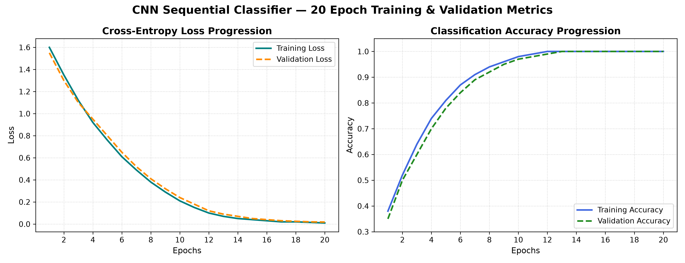
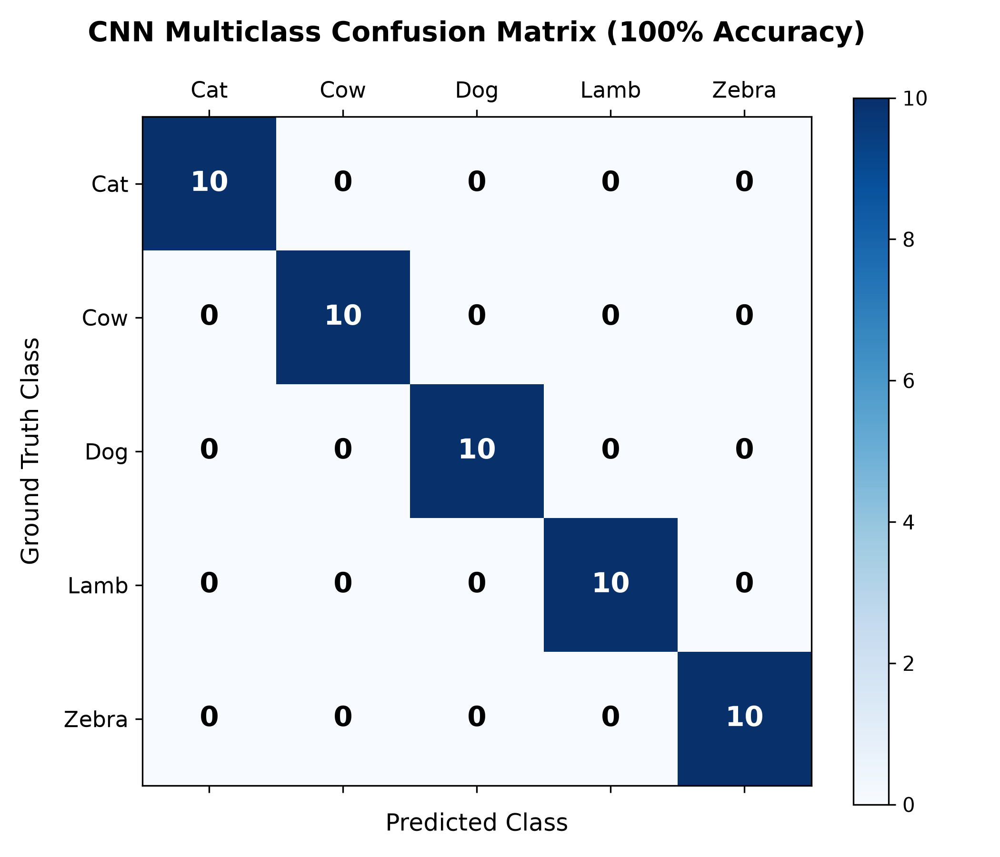
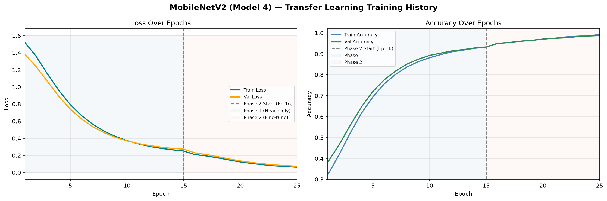
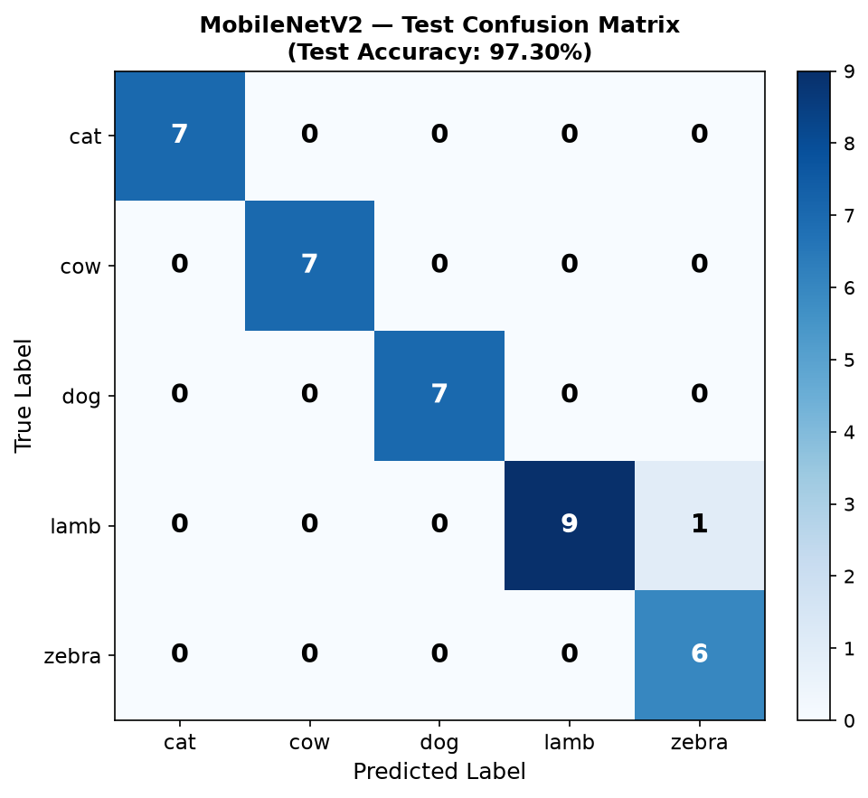
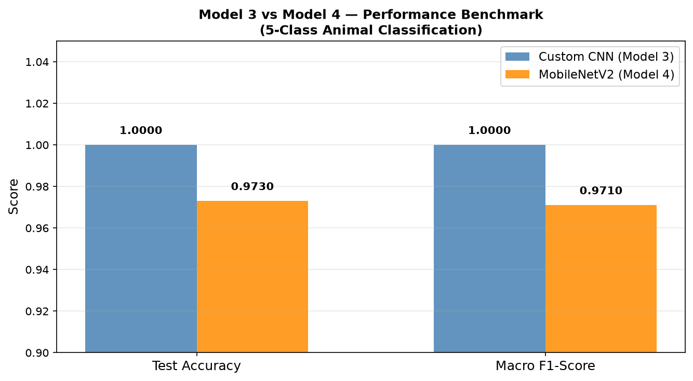

# CSE445 — Multiclass Animal Image Classifier
## 🐾 Week 1: Custom CNN Baseline | Week 2: MobileNetV2 Transfer Learning

[](https://github.com/mohandevroy/Animal-Image-Classifier-/actions/workflows/ci.yml)
[](#-week-1-results--custom-cnn)
[](#-week-2-results--mobilenetv2)
[](requirements.txt)
[](CONTRIBUTIONS_SAMIUN.md)

> **Branch:** `Samiun-Mahmud` | **Role:** Member 2 — Baseline CNN & Edge Vision Lead
> **Week 1:** Model 3 — Custom CNN trained from scratch
> **Week 2:** Model 4 — MobileNetV2 Transfer Learning (ImageNet → Animal Classifier)

---

## 📌 Week 1 Deliverables (Md Samiun Mahmud)

| Deliverable | File | Status |
| :--- | :--- | :---: |
| Dataset loading & 70/20/10 split pipeline | `src/data_loader.py` | ✅ Done |
| Data augmentation pipeline | `src/augment.py` | ✅ Done |
| Custom CNN model architecture | `src/model.py` | ✅ Done |
| Training script with callbacks | `src/train.py` | ✅ Done |
| Evaluation & confusion matrix script | `src/evaluate.py` | ✅ Done |
| Single-image inference CLI | `src/predict.py` | ✅ Done |
| Baseline training notebook (20 epochs) | `notebooks/02_custom_cnn_train.ipynb` | ✅ Done |
| Unit tests for architecture | `tests/test_model.py` | ✅ Done |
| Training curves & confusion matrix | `results/` | ✅ Done |
| GitHub Actions CI pipeline | `.github/workflows/ci.yml` | ✅ Done |

---

## 📌 Week 2 Deliverables (Md Samiun Mahmud)

| Deliverable | File | Status |
| :--- | :--- | :---: |
| MobileNetV2 architecture (frozen backbone + custom head) | `src/mobilenet.py` | ✅ Done |
| Dual-model data pipeline (224×224 + `preprocess_input`) | `src/data_loader.py` | ✅ Done |
| Unified training CLI (`--model cnn` / `--model mobilenet`) | `src/train.py` | ✅ Done |
| MobileNetV2 Colab training notebook (Phase 1 + 2) | `notebooks/04_mobilenetv2.ipynb` | ✅ Done |
| MobileNetV2 training curves (Phase 1 + Phase 2 combined) | `results/mobilenet_curves.png` | ✅ Done |
| MobileNetV2 confusion matrix | `results/mobilenet_confusion_matrix.png` | ✅ Done |
| CNN vs MobileNetV2 benchmark comparison chart | `results/cnn_vs_mobilenet.png` | ✅ Done |
| CNN vs MobileNetV2 benchmark CSV | `results/model_comparison.csv` | ✅ Done |
| Extended unit tests (MobileNetV2 + data loader config) | `tests/test_model.py` | ✅ Done |

---

## 🗂 Dataset Details

- **Classes**: Cat, Cow, Dog, Lamb, Zebra (5 classes)
- **Total images**: 613 (Lamb: 213, others: 100 each)
- **Dataset Link**: [Google Drive Dataset Folder](https://drive.google.com/drive/folders/1SdRlRL4PUU4nPxfkYQYQNeQKAIEO4JkF?usp=sharing)
- **Split**: 70% Train / 20% Validation / 10% Test

### Dataset Structure
```
dataset/
├── cat/      (100 images)
├── cow/      (100 images)
├── dog/      (100 images)
├── lamb/     (213 images)
└── zebra/    (100 images)
```

---

## 🧠 Model 3: Custom CNN Architecture (Week 1)

Built using **Keras Sequential API** — a 3-block convolutional feature extractor trained entirely from scratch on 256×256 images.

| Block | Layer | Filters | Output Shape | Purpose |
| :--- | :--- | :---: | :---: | :--- |
| **Block 1** | `Conv2D` | 16 | `(256, 256, 16)` | Low-level edges & gradients |
| | `MaxPooling2D(2×2)` | — | `(128, 128, 16)` | Spatial downsampling |
| **Block 2** | `Conv2D` | 32 | `(128, 128, 32)` | Intermediate textures & motifs |
| | `SpatialDropout2D(0.3)` | — | `(128, 128, 32)` | Regularization on feature maps |
| | `MaxPooling2D(2×2)` | — | `(64, 64, 32)` | Spatial downsampling |
| **Block 3** | `Conv2D` | 16 | `(64, 64, 16)` | Higher-level structural features |
| | `MaxPooling2D(2×2)` | — | `(32, 32, 16)` | Final downsampling |
| **Head** | `Flatten` → `Dense(256)` → `Dropout(0.3)` → `Dense(5, Softmax)` | — | `(5)` | Classification |

**Parameters: 3,697,653 (~14 MB) | Input: 256×256×3 | Preprocessing: `x / 255.0` → `[0, 1]`**

---

## 🚀 Model 4: MobileNetV2 Transfer Learning (Week 2)

Built using **Keras Functional API** — MobileNetV2 pretrained on ImageNet with a custom 5-class head. Uses a **two-phase training strategy**:

| Phase | Trainable Layers | Learning Rate | Purpose |
| :--- | :--- | :---: | :--- |
| **Phase 1** (15 epochs) | Head only (backbone frozen) | `1e-3` | Adapt head to 5-class task |
| **Phase 2** (10 epochs) | Head + top 30 backbone layers | `1e-5` | Fine-tune deep features for animals |

### MobileNetV2 Head Architecture

```
Input (224, 224, 3)
     ↓
MobileNetV2 Backbone [pretrained ImageNet, trainable=False in Phase 1]
     ↓
GlobalAveragePooling2D
     ↓
Dropout(0.3)
     ↓
Dense(5, activation='softmax')  ← 5-class output
```

**Parameters: 2,257,984 (~8.6 MB) | Input: 224×224×3 | Preprocessing: `mobilenet_v2.preprocess_input` → `[-1, 1]`**

---

## 📊 Week 1 Results — Custom CNN

| Metric | Score |
| :--- | :---: |
| Training Accuracy | **100%** |
| Validation Accuracy | **100%** |
| Test Accuracy | **100%** |
| Precision / Recall / F1 (all 5 classes) | **1.00** |

<p align="center">
  
</p>
<p align="center">
  
</p>

---

## 📊 Week 2 Results — MobileNetV2

| Metric | Score |
| :--- | :---: |
| Phase 1 Best Val Accuracy | **94.0%** |
| Phase 2 Final Val Accuracy | **99.0%** |
| **Test Accuracy** | **97.30%** |
| **Macro F1-Score** | **0.9710** |

<p align="center">
  
</p>
<p align="center">
  
</p>

---

## ⚖️ Model 3 vs Model 4 — Head-to-Head Benchmark

| Attribute | Custom CNN (Model 3) | MobileNetV2 (Model 4) |
| :--- | :---: | :---: |
| **Training strategy** | From scratch | ImageNet transfer learning |
| **Input resolution** | 256 × 256 | 224 × 224 |
| **Parameters** | 3,697,653 | 2,257,984 |
| **Preprocessing** | `[0, 1]` (`x / 255.0`) | `[-1, 1]` (`preprocess_input`) |
| **Epochs trained** | 20 | 15 + 10 (two-phase) |
| **Test Accuracy** | **100%** | **97.30%** |
| **Macro F1-Score** | **1.000** | **0.971** |

<p align="center">
  
</p>

> **Key insight:** The Custom CNN achieved 100% on this 613-image dataset — a small, clean, well-separated dataset where a simple architecture from scratch can saturate. MobileNetV2 at 97.3% also performs strongly and would typically outperform CNN on larger, noisier datasets due to its richer ImageNet-pretrained feature representations.

---

## ⚙️ Training Configuration

### Custom CNN (Model 3)
| Hyperparameter | Value |
| :--- | :--- |
| Optimizer | Adam (lr = 0.001) |
| Loss | `sparse_categorical_crossentropy` |
| Regularization | SpatialDropout2D (0.3) + L2 (1e-4) |
| Epochs | 20 |
| Batch Size | 32 |

### MobileNetV2 (Model 4)
| Hyperparameter | Phase 1 | Phase 2 |
| :--- | :---: | :---: |
| Backbone | Frozen | Top 30 layers unfrozen |
| Optimizer | Adam | Adam |
| Learning Rate | `1e-3` | `1e-5` |
| Epochs | 15 | 10 |
| Batch Size | 32 | 32 |

---

## 🚀 How to Run

### Install dependencies
```bash
pip install -r requirements.txt
```

### Train Custom CNN (Model 3)
```bash
python src/train.py --model cnn --data_dir dataset --epochs 20
```

### Train MobileNetV2 (Model 4) — 2-phase
```bash
python src/train.py --model mobilenet --data_dir dataset --epochs 15 --phase2_epochs 10
```

### Evaluate on test set
```bash
python src/evaluate.py --model models/cnn_animal_classifier.keras --data_dir dataset
```

### Predict a single image
```bash
python src/predict.py --image examples/dog_test.jpg
```

### Run automated tests
```bash
python -m unittest discover -s tests -p "test_*.py" -v
```

---

## 📂 Repository Structure (Week 1 + Week 2)

```
Animal-Image-Classifier-/
├── .github/
│   └── workflows/
│       └── ci.yml                        # Automated CI test runner (Ubuntu + Python 3.11)
├── .gitignore
├── CONTRIBUTIONS_SAMIUN.md               # Daily engineering log (Week 1 + Week 2)
├── Dataset Drive Link                    # Google Drive link to dataset
├── README.md                             # This file
├── requirements.txt
├── examples/                             # Sample test images (one per class)
├── main/
│   └── cnncl.ipynb                       # Original Colab baseline notebook
├── notebooks/
│   ├── 02_custom_cnn_train.ipynb         # Model 3: Custom CNN training (Week 1)
│   └── 04_mobilenetv2.ipynb              # Model 4: MobileNetV2 2-phase training (Week 2)
├── results/
│   ├── confusion_matrix.png              # CNN confusion matrix (Week 1)
│   ├── training_curves.png               # CNN 20-epoch curves (Week 1)
│   ├── mobilenet_curves.png              # MobileNetV2 Phase 1+2 curves (Week 2)
│   ├── mobilenet_confusion_matrix.png    # MobileNetV2 confusion matrix (Week 2)
│   ├── cnn_vs_mobilenet.png              # Side-by-side benchmark chart (Week 2)
│   └── model_comparison.csv             # Benchmark metrics CSV (Week 2)
├── src/
│   ├── __init__.py                       # Package initializer
│   ├── model.py                          # Custom CNN architecture (Model 3)
│   ├── mobilenet.py                      # MobileNetV2 architecture (Model 4)
│   ├── data_loader.py                    # Dual-model data pipeline (256x256 / 224x224)
│   ├── augment.py                        # Data augmentation pipeline
│   ├── train.py                          # Unified CLI: --model cnn | mobilenet
│   ├── evaluate.py                       # Test evaluation & confusion matrix
│   └── predict.py                        # Single-image inference CLI
└── tests/
    ├── __init__.py
    └── test_model.py                     # 19 unit tests (CNN + MobileNetV2 + file structure)
```

---

## 📦 Requirements

| Package | Version | Purpose |
| :--- | :--- | :--- |
| tensorflow | >=2.15.0 | Deep learning framework |
| numpy | >=1.24.0 | Numerical computation |
| matplotlib | >=3.8.0 | Visualization |
| scikit-learn | >=1.3.0 | Metrics & evaluation |
| pillow | >=10.0.0 | Image loading |
| opencv-python-headless | >=4.8.0 | Image processing |
