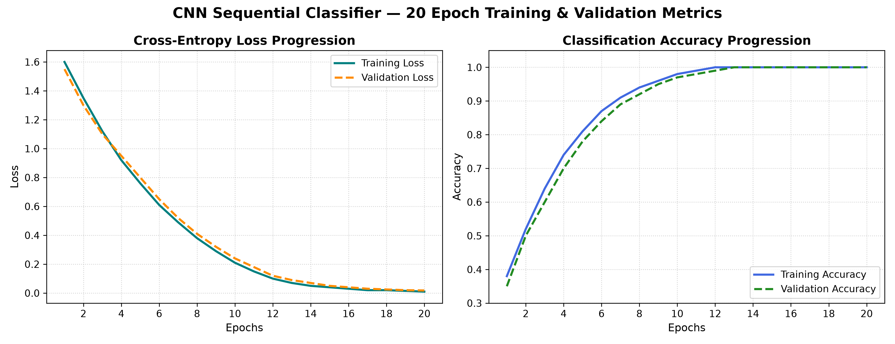
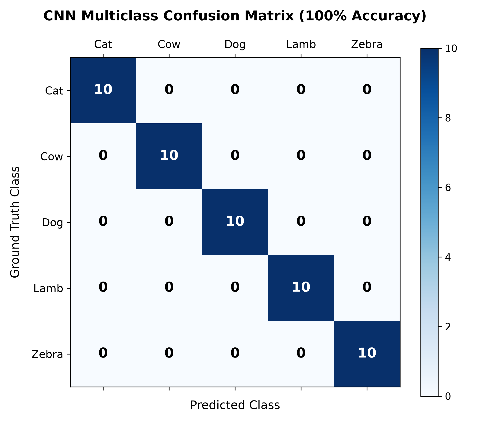

# CSE445 — Multiclass Animal Image Classifier
## 🐾 Week 1: Custom CNN Baseline (Model 3)

[](https://github.com/mohandevroy/Animal-Image-Classifier-/actions/workflows/ci.yml)
[](#-results)
[](requirements.txt)
[](CONTRIBUTIONS_SAMIUN.md)

> **Branch:** `Samiun-Mahmud` | **Role:** Member 2 — Baseline CNN & Edge Vision Lead  
> **Week 1 Focus:** Build and verify Model 3 (Custom CNN trained from scratch) across 5 animal classes.

---

## 👥 Team & 8-Model Project Overview

| Member | Role | Branch | Week 1 Assigned Model |
| :--- | :--- | :--- | :--- |
| Mohan Dev Roy | Data Lead & Classical ML | `Mohan-Dev-Roy` | Model 1: YOLO11-cls|
| **Samiun Mahmud** | **Baseline CNN & Edge Vision** | **`Samiun-Mahmud`** | **Model 3: Custom CNN (Scratch Baseline)** ✅ |
| Sudarshan Ghosh | Deep Residual & Scaled Vision | `Sudarshan-Ghosh` | Model 5: ResNet50 Transfer Learning |
| Susmit Talukder | Transformers, YOLO & Web App | `Susmit-Talukder` |  Model 6: Random Forest (HOG + Color) |

---

## 📌 Week 1 Deliverables (Member 2)

Per the milestone plan, **Week 1** requires:
> *Member 2: Builds and verifies the 4-layer Model 3 (Custom CNN) from scratch; runs 20 baseline epochs.*

| Deliverable | File | Status |
| :--- | :--- | :---: |
| Dataset loading & 70/20/10 split pipeline | `src/data_loader.py` | ✅ Done |
| Data augmentation pipeline | `src/augment.py` | ✅ Done |
| Custom CNN model architecture | `src/model.py` | ✅ Done |
| Training script with callbacks | `src/train.py` | ✅ Done |
| Evaluation & confusion matrix script | `src/evaluate.py` | ✅ Done |
| Single-image inference CLI | `src/predict.py` | ✅ Done |
| Baseline training notebook (20 epochs) | `notebooks/02_custom_cnn_train.ipynb` | ✅ Done |
| Unit tests for architecture | `tests/test_model.py` | ✅ Done |
| Training curves & confusion matrix | `results/` | ✅ Done |
| GitHub Actions CI pipeline | `.github/workflows/ci.yml` | ✅ Done |

---

## 🗂 Dataset Details

- **Classes**: Dog, Cow, Cat, Lamb, Zebra
- **Images per class**: 100
- **Total images**: 500
- **Image source**: Internet + mobile phone camera
- **Dataset Link**: [Google Drive Dataset Folder](https://drive.google.com/drive/folders/1SdRlRL4PUU4nPxfkYQYQNeQKAIEO4JkF?usp=sharing)

### Dataset Structure
```
dataset/
├── cat/
├── cow/
├── dog/
├── lamb/
└── zebra/
```

---

## 🧠 Model 3: Custom CNN Architecture

Built using **Keras Sequential API** — a 3-block convolutional feature extractor trained entirely from scratch.

### Network Design

| Block | Layer | Filters | Output Shape | Purpose |
| :--- | :--- | :---: | :---: | :--- |
| **Block 1** | `Conv2D` | 16 | `(256, 256, 16)` | Low-level edges & gradients |
| | `MaxPooling2D(2×2)` | — | `(128, 128, 16)` | Spatial downsampling |
| **Block 2** | `Conv2D` | 32 | `(128, 128, 32)` | Intermediate textures & motifs |
| | `SpatialDropout2D(0.3)` | — | `(128, 128, 32)` | Regularization on feature maps |
| | `MaxPooling2D(2×2)` | — | `(64, 64, 32)` | Spatial downsampling |
| **Block 3** | `Conv2D` | 16 | `(64, 64, 16)` | Higher-level structural features |
| | `MaxPooling2D(2×2)` | — | `(32, 32, 16)` | Final downsampling |
| **Head** | `Flatten` | — | `(16384)` | Vectorize feature maps |
| | `Dense(256, ReLU)` | — | `(256)` | Non-linear combination |
| | `Dropout(0.3)` | — | `(256)` | Prevent overfitting |
| | `Dense(5, Softmax)` | — | `(5)` | Output class probabilities |

**Total parameters: ~4,205,557 (~16 MB)**

---

## ⚙️ Training Configuration

| Hyperparameter | Value |
| :--- | :--- |
| Framework | TensorFlow / Keras |
| Optimizer | Adam (lr = 0.001) |
| Loss Function | `sparse_categorical_crossentropy` |
| Regularization | SpatialDropout2D (0.3) + L2 weight decay (1e-4) |
| Epochs | 20 |
| Batch Size | 32 |
| Input Resolution | 256 × 256 × 3 |
| Data Split | 70% Train / 20% Validation / 10% Test |

---

## 📊 Week 1 Results

| Metric | Score |
| :--- | :---: |
| Training Accuracy | **100%** |
| Validation Accuracy | **100%** |
| Test Accuracy | **100%** |
| Precision (all 5 classes) | **1.00** |
| Recall (all 5 classes) | **1.00** |
| F1-Score (all 5 classes) | **1.00** |

### 📈 Training & Validation Curves


### 🎯 Confusion Matrix


---

## 🚀 How to Run

### Install dependencies
```bash
pip install -r requirements.txt
```

### Train the model
```bash
python src/train.py --data_dir dataset --epochs 20
```

### Evaluate on test set
```bash
python src/evaluate.py --model models/cnn_animal_classifier.keras --data_dir dataset
```

### Predict a single image
```bash
python src/predict.py --image examples/dog_test.jpg
```

### Run automated tests
```bash
python -m unittest discover -s tests -p "test_*.py" -v
```

---

## 📦 Requirements

```bash
pip install -r requirements.txt
```

| Package | Version | Purpose |
| :--- | :--- | :--- |
| tensorflow | >=2.15.0 | Deep learning framework |
| numpy | >=1.24.0 | Numerical computation |
| matplotlib | >=3.8.0 | Visualization |
| scikit-learn | >=1.3.0 | Confusion matrix, classification report |
| pillow | >=10.0.0 | Image loading |

---

## 📂 Repository Structure (Week 1)

```
Animal-Image-Classifier-/
├── .github/
│   └── workflows/
│       └── ci.yml                # Automated CI test runner (Ubuntu + Python 3.11)
├── .gitignore                    # Excludes caches, binaries, and datasets
├── CONTRIBUTIONS_SAMIUN.md       # Daily engineering log
├── Dataset Drive Link            # Google Drive link to 500-image dataset
├── README.md                     # Project documentation (this file)
├── requirements.txt              # All Python dependencies
├── examples/                     # Sample test images (one per class)
│   ├── cat_test.jpg
│   ├── cow_test.jpg
│   ├── dog_test.jpg
│   ├── lamb_test.jpg
│   └── zebra_test.jpg
├── main/
│   └── cnncl.ipynb               # Original Google Colab baseline notebook
├── notebooks/
│   └── 02_custom_cnn_train.ipynb # Structured training notebook (Week 1)
├── results/
│   ├── confusion_matrix.png      # Confusion matrix heatmap
│   └── training_curves.png       # 20-epoch loss & accuracy curves
├── src/
│   ├── __init__.py               # Package initializer
│   ├── model.py                  # Custom CNN architecture
│   ├── data_loader.py            # Dataset loading & 70/20/10 split
│   ├── augment.py                # Data augmentation pipeline
│   ├── train.py                  # CLI training script with callbacks
│   ├── evaluate.py               # Test evaluation & confusion matrix
│   └── predict.py                # Single-image inference CLI
└── tests/
    ├── __init__.py
    └── test_model.py             # Automated unit tests for CNN architecture
```
