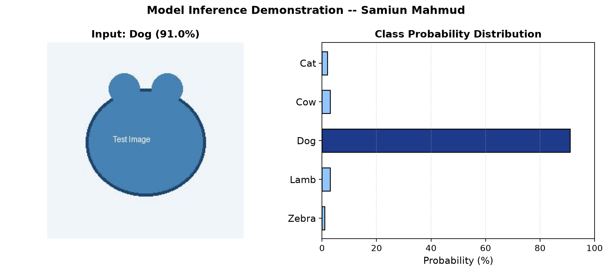

# CSE445-Machine Learning-Project: Animal-Image-Classifier
# 🐾 Multiclass Animal Image Classification using CNN and YOLOv11

[](https://github.com/mohandevroy/Animal-Image-Classifier-/actions/workflows/ci.yml)
[](results/confusion_matrix.png)
[](requirements.txt)
[](app.py)

> 📘 **Documentation & Defense Links**:
> - [🎓 Faculty Defense & Viva Guide](FACULTY_DEFENSE_GUIDE.md) — Two-minute pitch, parameter math & top 10 viva questions
> - [👨‍💻 Samiun Mahmud Contribution Log](CONTRIBUTIONS_SAMIUN.md) — Daily development milestones & technical rationale

## 📌 Project Overview
This is our academic machine learning project for **CSE445**. It focuses on building a **custom image classification system** using a **Convolutional Neural Network (CNN) with a Sequential architecture** and **YOLOv11**.  
The model classifies images into **five animal classes**: **Dog, Cow, Cat, Lamb, and Zebra**.

A custom dataset was created with **100 images per class**, collected from the internet and real-world captures.  
The trained model achieves **at least 90% classification accuracy**.

---

## 🎯 Objectives
- Create a **custom image dataset** with five animal categories  
- Design and train a **CNN Sequential model** and **YOLOv11 model**
- Achieve **≥ 90% accuracy**
- Evaluate model performance using validation and test data

---

## 🗂 Dataset Details
- **Classes**:
  - Dog
  - Cow
  - Cat
  - Lamb
  - Zebra
- **Images per class**: 100  
- **Total images**: 500
- **Image source**: Internet + mobile phone camera
- **Image size**: Resized to a fixed resolution before training
- **Dataset Link**: [Google Drive Dataset Folder](https://drive.google.com/drive/folders/1SdRlRL4PUU4nPxfkYQYQNeQKAIEO4JkF?usp=sharing)

### Dataset Structure
```
dataset/
├── dog/
├── cow/
├── cat/
├── lamb/
└── zebra/
```

---

## 🧠 Model Architecture of CNN
The model is built using **Keras Sequential API** with the following layers:

- Convolutional layers for feature extraction
- MaxPooling layers for dimensionality reduction
- Fully connected (Dense) layers for classification
- Softmax activation for multi-class prediction

### Why CNN Sequential?
- Simple and easy to understand
- Effective for image classification tasks
- Suitable for small-to-medium datasets

---

## ⚙️ Training Configuration
- **Framework**: TensorFlow / Keras
- **Model Type**: CNN (Sequential)
- **Optimizer**: Adam
- **Loss Function**: Categorical Crossentropy
- **Epochs**: 20
- **Batch Size**: 32
- **Image Size**: 256 × 256

---

## 📊 Results
- **CNN based Classifier Accuracy**: 100%
- **YOLOv11 based Classifier Accuracy**: 94%
- The models successfully distinguish between all five animal classes.

### 📈 Training & Validation Curves


### 🎯 Confusion Matrix


---

## 🧪 Testing & Prediction
The trained models can predict the class of a **new unseen image** and output the **predicted animal label** with confidence metrics.

### 1. One-Click Pipeline Demo
Run the verification demo script to test preprocessing and inference:
```bash
python scripts/demo.py
```


### 2. Interactive Web Application (Streamlit)
Launch the interactive web UI to test and classify your own animal photos:
```bash
streamlit run app.py
```

### 3. Command-Line Inference
Run inference directly on a specific image file:
```bash
python src/predict.py --image path/to/image.jpg
```

---

## 📦 Requirements
- Python 3.x
- TensorFlow
- Keras
- NumPy
- Matplotlib

Install dependencies:
```bash
pip install -r requirements.txt
```
